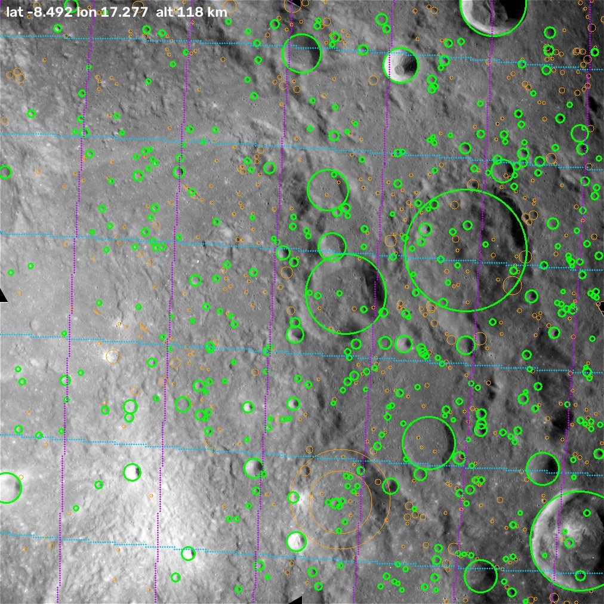
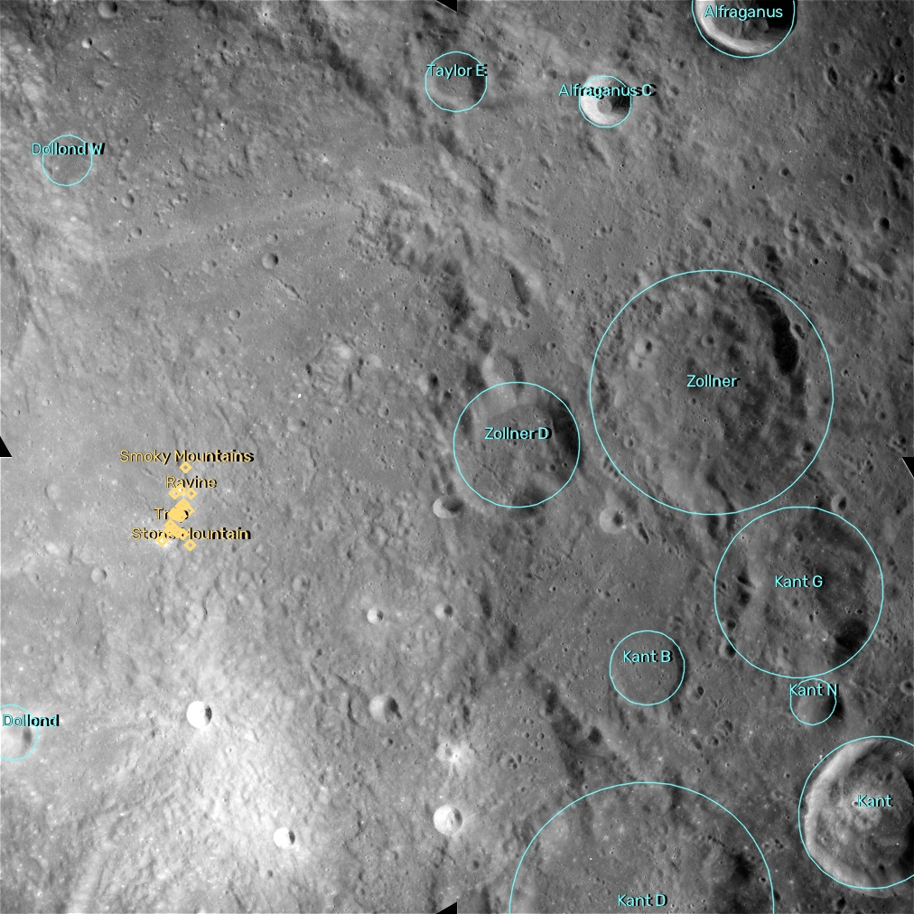

# lunar-platesolve

`lunar-platesolve` finds where a photo of the Moon was taken. The input is one image of the
lunar surface. No other data is necessary. The output is the camera position (latitude,
longitude and altitude), the camera attitude, the focal length, and the latitude and longitude
of every pixel.

The method is the method of star plate solving (astrometry.net). Impact craters replace the
stars. A neural network finds the craters in the image. A hash index of crater "constellations"
from a catalog of 1.3 million craters gives candidate positions. A statistical test accepts or
rejects each candidate. A camera model fit gives the final pose.



*Apollo 16 Metric Camera frame AS16-M-1657 (NASA/JSC/ASU), solved with no other input. Green
circles: 384 craters that match the catalog. Orange circles: other detections. Lines: latitude
and longitude every 0.5°. The solved camera position is 0.7 km from the Apollo ephemeris.*

---

## Contents

1. [Goals and scope](#1-goals-and-scope)
2. [Quick start](#2-quick-start)
3. [Interface: input and output](#3-interface-input-and-output)
4. [How it works: overview](#4-how-it-works-overview)
5. [Data](#5-data)
6. [Crater detector: CraterNet](#6-crater-detector-craternet)
7. [Catalog and quad index](#7-catalog-and-quad-index)
8. [Solver](#8-solver)
9. [Oblique views: the limb path](#9-oblique-views-the-limb-path)
10. [Multi-camera rig](#10-multi-camera-rig)
11. [Fine catalog](#11-fine-catalog)
12. [Named features and pixel lookup](#12-named-features-and-pixel-lookup)
13. [Results](#13-results)
14. [Limits](#14-limits)
15. [Repository layout](#15-repository-layout)
16. [Setup, training and benchmarks](#16-setup-training-and-benchmarks)
17. [Open items](#17-open-items)
18. [Data sources](#18-data-sources)

---

## 1. Goals and scope

**Goal.** Solve a lunar image *blind*. "Blind" means that the solver gets no position hint, no
attitude and, optionally, no focal length. The solver must also be fast and must not give wrong
answers. A wrong answer is worse than no answer, so every solution passes a statistical test.

**Analogy with star plate solving.**

| Star plate solving | Lunar plate solving |
|---|---|
| star centroid | crater centre |
| star brightness ranks the stars | crater diameter ranks the craters. The diameter is also a measured quantity in the hash code. |
| star catalog (Gaia, Tycho) | Robbins (2019) lunar crater database: 1,296,796 craters, complete to about 1–2 km diameter |
| quad of 4 stars → 4-D hash code | quad of 4 craters → 8-D hash code (4 geometry terms, 4 radius terms) |
| the sky is a sphere seen from the inside | the Moon is a sphere seen from the outside, so the solver fits a full pinhole camera |

**What works now.**
* Near-nadir and oblique images, from about 30 km to 1500 km altitude.
* Unknown focal length. The solver estimates the focal length.
* Mirrored images (for example from a telescope with a star diagonal).
* Strongly oblique images that show the Moon's limb (edge against space).
* Low sun and high sun. Very high sun is partly solved (see [Results](#13-results)).

**What does not work now.** See [Limits](#14-limits). The main limits are small footprints,
the darkest and brightest lighting, and strongly oblique images without a visible limb.

---

## 2. Quick start

```bash
python -m lunarsolve image.png
python -m lunarsolve image.png --overlay solved.png --json result.json
python -m lunarsolve image.png --fov 20          # if you know the horizontal field of view
```

Example output (held-out test image `examples/wac_view.png`, rendered from 250 km altitude,
20° field of view, 12° tilt, solved with no focal length):

```
loaded catalog and index in 3.5s
894 craters detected in 1193 ms
camera        lat -23.4736  lon 345.0131  altitude 250.0 km +/- 3.6 (focal length estimated)
image centre  lat -25.1502  lon 344.3340  GSD 88 m/px  heading 30.0 deg  off-nadir 12.1 deg
focal 2936 px (FOV 19.78 deg)  mirrored=False
35 crater matches, rms 0.89 px, log-odds 170, 2154 ms
```

The first detection call includes CUDA start-up. A warm call takes about 65 ms for a
1-megapixel image.

The true camera is at −23.5°, 345.0°, 250 km. The true field of view is 20°. The true heading
is 30°. The true off-nadir angle is 12°.

**Website and HTTP API.** `web/` is a static website (no build step) for GitHub Pages.
`server/api.py` is the HTTP API that the website calls. Run both on your computer:

```bash
python server/api.py --web          # then open http://127.0.0.1:8000
```

* Drop, paste or choose an image, or click an example. The solve starts at once. Optional camera
  details (field of view, parity, time limit, high precision) are in a folded panel.
* The result page shows the camera latitude, longitude and altitude with the 1-sigma, the
  nearest named feature, and a confidence badge. The image viewer zooms and pans, shows layers
  (matched craters, all detections, latitude/longitude grid, IAU names), gives the coordinates
  under the cursor, and gives the LOLA elevation and nearest named feature of a clicked point.
  A 3-D globe (three.js) flies to the footprint and shows the camera and its view cone.
* The page converts pixels to latitude/longitude itself, from the camera in the response.
* `web/config.js` sets the API address. A query parameter overrides it:
  `index.html?api=https://...`.

API:

| Endpoint | Input | Output |
|---|---|---|
| `GET /api/health` | | status, version, `human_check` |
| `POST /api/solve` | multipart: `image`; optional `fov_deg`, `parity`, `max_time`, `labels`, `refine`; `turnstile` (token) when the human check is on | `ok`, `detections` (x, y, r, score), `solution` (camera position and 1-sigma, image centre, GSD, heading, off-nadir angle, FOV, camera centre `C`, rotation `Rwc`, focal length, principal point, footprint, matched detections, named features with outlines) |
| `GET /api/lookup?lat=&lon=` | ground point | LOLA elevation, nearest named feature |

```bash
curl -F image=@photo.png -F fov_deg=20 http://127.0.0.1:8000/api/solve
```

**Deployment.** The website deploys to GitHub Pages (`.github/workflows/pages.yml`). The API is
published through a Cloudflare Tunnel: the public hostname belongs to the tunnel, not to the
machine, so the server can move without a change on the website.

* Data: the 6 files of `server/fetch_data.py` (about 1 GB) are in the Hugging Face dataset
  `turtlely/lunarsolve-data` (uploaded with `scripts/deploy_hf.py --user <name>`). A new server
  downloads them from there.
* Windows PC (GPU): put the tunnel token in `deploy/server/.env` (copy `.env.example`), then run
  `powershell -ExecutionPolicy Bypass -File scripts\serve.ps1`. It starts the API on
  127.0.0.1:8000 and the tunnel. `-Quick` gives a temporary `trycloudflare.com` address without
  a Cloudflare account.
* Any Linux server (CPU, x86-64 or ARM64): copy the repository and `deploy/server/.env`, then
  `docker compose -f deploy/server/docker-compose.yml up -d --build`. The tunnel container
  shares the API container's network, so the tunnel target is `http://localhost:8000` in both
  cases.
* Linux server without root access or open ports: `bash deploy/server/setup_user.sh` installs Python
  3.12 (uv), CPU torch, the data and `cloudflared` into the home directory; `bash
  deploy/server/run.sh` starts the API and the tunnel (`--quick`: temporary address, no DNS).
* Linux server with a public IP address and a domain: set `DOMAIN` in `deploy/server/.env`, point a DNS
  A record to the server, open ports 80 and 443, then
  `docker compose -f deploy/server/docker-compose.caddy.yml up -d --build`. Caddy gets the HTTPS
  certificate. Without Docker: `deploy/server/lunarsolve-api.service` (systemd).
* Server size: at least 6 GB of RAM (two catalogs and two detectors), 2 or more CPU cores, about
  8 GB of disk for the image and data.
* CPU speed: about 2–6 s per 1-megapixel image with 2 threads. The WAC mosaic is not part of the
  server data, so high precision is off on servers that do not have it.
* `deploy/hf-space/` and `scripts/deploy_hf.py` also deploy to a Hugging Face Docker Space (this
  needs a PRO account).

Set `web/config.js` to the public API address.

**Access control** (`server/api.py`, environment variables in `deploy/server/.env`). A static
website calls the API from the visitor's browser, so the API address is always public. These
layers limit what other programs can do with it:

| Layer | Setting | Effect |
|---|---|---|
| Human check | `TURNSTILE_SECRET` (server), `turnstileSiteKey` (`web/config.js`) | Each solve needs a one-use Cloudflare Turnstile token from the website. Scripts get HTTP 403. |
| Browser origin | `ALLOWED_ORIGINS` (default `https://lunar.rtang.dev`) | Other websites cannot call the API from a browser (CORS). |
| Rate limit | `RATE_SOLVE` (default `6/60`), `RATE_LOOKUP` (`60/60`) | Requests per visitor IP (`CF-Connecting-IP`) per window in seconds. Over the limit: HTTP 429 with `Retry-After`. |
| One solve at a time | built in | A second solve waits up to 20 s, then gets HTTP 503. |
| API docs | `ENABLE_DOCS=0` | `/docs` and `/openapi.json` are off. |
| Container | `docker-compose.yml` | No published ports, non-root user, no capabilities, no privilege escalation, memory and process limits. |

A Cloudflare WAF rate-limiting rule on `/api/solve` adds a second limit before requests reach the
server. For local tests, `web/config.js` uses Cloudflare's test site key on `localhost`, and the
test secret `1x0000000000000000000000000000000AA` always passes.

**Gradio demo** (local research app, needs the GPU and the data from
[section 16](#16-setup-training-and-benchmarks), plus `pip install gradio plotly`):

```bash
python demo/app.py          # then open http://127.0.0.1:7860
```

* Tab *Solve an image*: upload a photo, or choose one of the examples (a simulated WAC view, an
  Apollo 16 vertical frame, an Apollo 16 oblique frame with the limb, and an Apollo 17 high-sun
  frame). The demo shows the detected and matched craters with a latitude/longitude grid, the
  IAU names of the craters and other features in view, the footprint on the WAC mosaic, the
  position on a global map, and all solution values. Click on the solved image to read the
  latitude, longitude, elevation and nearest named feature of any pixel.
* Tab *Simulate a camera*: set the camera latitude, longitude, altitude, field of view, tilt and
  heading with sliders. Choose the renderer (real WAC mosaic on LOLA terrain, or LOLA terrain
  with Clementine albedo and a sun that you set). The demo renders the view, solves the view
  blind, and compares the solution with the truth.
* Tab *Multi-camera rig*: select a spacecraft preset (nadir + fore/aft cameras), set the
  sub-spacecraft point, the orbit altitude, the inclination and the pass direction. The demo
  renders the three views at the same instant, solves them as one rig, and compares the rig
  solution with the truth and with each camera alone. Two 3-D plots show the rig geometry (terrain,
  spacecraft, camera frusta and footprints) and the solved positions around the truth in metres
  (the rig with its 1-sigma ellipsoid, each single camera with its altitude 1-sigma). A download
  gives the rendered images and a `truth.json` file (see [section 10](#10-multi-camera-rig)).

Python:

```python
import cv2
from lunarsolve.solve import Solver
from lunarsolve.detect import to_gray_float

solver = Solver()                     # loads the catalog and the index (about 4 s); reuse it
img = to_gray_float(cv2.imread("image.png", cv2.IMREAD_UNCHANGED))
sol = solver.solve(img=img)           # optional: fov_deg=..., focal_px=..., max_time=...
if sol is not None:
    print(sol.summary())
    lat, lon = sol.pixel_to_latlon([100.0, 500.0], [200.0, 300.0])
```

---

## 3. Interface: input and output

### 3.1 Input

| Input | Required | Description |
|---|---|---|
| image | yes | Any format that OpenCV reads (PNG, TIFF, JPEG). 8-bit or 16-bit, grayscale or colour. The solver converts colour to grayscale and scales the image so that the 99.9th percentile is 1. |
| `--fov` / `fov_deg` | no | Horizontal field of view in degrees. |
| `--focal` / `focal_px` | no | Focal length in pixels. Do not give `--fov` and `--focal` together. |
| `--parity` / `parity` | no | `both` (default), `normal` or `mirrored`. Use `normal` if you know that the image is not mirrored. The search is then faster. |
| `--max-time` / `max_time` | no | Time budget in seconds (default 30 for the CLI, 20 for the API). |
| `--weights` | no | A different CraterNet weights file. |
| `--device` | no | `cuda` (default) or `cpu`. |

The camera model is a pinhole camera with the principal point at the image centre and no lens
distortion. Square pixels are assumed.

### 3.2 Output

`Solver.solve()` returns a `Solution` object, or `None` if no solution passes the test.

| Field | Unit | Meaning |
|---|---|---|
| `camera_lat`, `camera_lon` | degrees | Latitude and longitude of the point directly below the camera. Planetocentric latitude. East-positive longitude in $[0, 360)$. |
| `altitude_km` | km | Height of the camera above the reference sphere of radius $R = 1737.4$ km. |
| `altitude_sigma_km` | km | One-sigma uncertainty of the altitude. Large values mean that the data do not separate altitude from focal length (see [8.7](#87-camera-fit)). |
| `focal_px`, `fov_deg` | px, degrees | Focal length and horizontal field of view. |
| `focal_estimated` | bool | `True` if the solver estimated the focal length. |
| `center_lat`, `center_lon` | degrees | Ground point at the image centre pixel. |
| `boresight_lat`, `boresight_lon` | degrees | Ground point on the optical axis. |
| `gsd_km` | km/px | Ground sample distance at the image centre. |
| `heading_deg` | degrees | Azimuth of the image "up" direction at the image centre, clockwise from north. |
| `off_nadir_deg` | degrees | Angle between the optical axis and the local vertical at the camera. |
| `mirrored` | bool | `True` if the image is a mirror image. |
| `n_matches` | — | Number of detected craters that match catalog craters. |
| `log_odds` | — | Natural-log odds of the solution against chance (see [8.5](#85-the-log-odds-score)). |
| `rms_px` | px | RMS reprojection error of the matched craters. |
| `method` | — | `direct`, or `limb` if the solver used the limb path. |
| `C`, `Rwc` | km, — | Camera centre in the Moon-fixed frame, and the world-to-camera rotation matrix. |
| `matches`, `dets` | — | Matched pairs (row in `dets`, catalog index) and the detections used. |

`Solution.pixel_to_latlon(u, v)` gives the latitude and longitude of any pixels.
`Solution.to_dict()` gives the scalar fields. The CLI option `--json` writes these fields.

**Coordinate frames.**
* Moon-fixed frame: $+x$ points to latitude 0°, longitude 0°. $+z$ points to the north pole.
* Camera frame: $+x$ is image right, $+y$ is image down, $+z$ is the optical axis.
* Pixel coordinates $(u, v)$: $u$ to the right, $v$ down. The origin is the centre of the
  top-left pixel.

### 3.3 Altitude and focal length

The image scale gives only the ratio $h / f$ of altitude to focal length. The altitude itself
comes from perspective effects: the keystone distortion of a tilted view, the curvature of the
Moon across the footprint, and the limb. Wide or tilted views contain enough perspective, and
the solver estimates $h$ and $f$ together. Narrow near-nadir views do not. For those views
the solver reports a large `altitude_sigma_km`, and the CLI prints a note. Give `--fov` or
`--focal` for those views.

---

## 4. How it works: overview

```
                    ┌──────────────────────────────────────────────────────────┐
image ──► limb? ─no─►  CraterNet ──► craters (x, y, r) ──► quads ──► 8-D codes   │
            │       │                                                    │       │
            │yes    │   KD-tree lookup in 8.6 M catalog quads ◄──────────┘       │
            ▼       │        │                                                   │
   cone fit to the  │        ▼                                                   │
   limb: tilt,      │   hypotheses, closest code first                           │
   altitude         │        │                                                   │
            │       │        ▼                                                   │
   re-project to a  │   vectorized pre-filter ──► exact check ──► grow the match │
   nadir view ──────┤        │                    (similarity → affine →         │
   (+ scale prior)  │        │                     homography)                   │
                    │        ▼                                                   │
                    │   log-odds test ──► pinhole camera fit (PnP + LM)          │
                    │        │            re-match through the camera          │
                    │        ▼                                                   │
                    │   acceptance rules ──► Solution                            │
                    └──────────────────────────────────────────────────────────┘
```

Steps:
1. **Limb check.** If the image shows the Moon's limb and the view is tilted by more than 15°,
   the solver fits the limb. The fit gives tilt and altitude. The solver then re-projects the
   image to a virtual camera that looks straight down ([section 9](#9-oblique-views-the-limb-path)).
2. **Detection.** CraterNet finds craters and gives a centre and a radius for each crater
   ([section 6](#6-crater-detector-craternet)).
3. **Hashing.** The solver makes quads of 4 craters and computes an 8-D code for each quad.
   The code does not change under rotation, scale and translation of the image
   ([section 7](#7-catalog-and-quad-index)).
4. **Lookup.** A KD-tree gives catalog quads with similar codes. Each catalog quad gives a
   hypothesis for the image position ([section 8](#8-solver)).
5. **Verification.** The solver projects catalog craters into the image and counts matches.
   A log-likelihood ratio compares the hypothesis with chance.
6. **Camera fit.** The solver fits a pinhole camera to all matches. Then it re-matches all
   detections through the camera and fits again.

---

## 5. Data

| Dataset | Size | Used for |
|---|---|---|
| Robbins (2019) lunar crater database | 238 MB CSV, 1,296,796 craters | Solver catalog. Training labels. |
| LOLA `LDEM_64` elevation model (64 px/deg, 473 m/px) | 531 MB | Crater rim heights. Training renders. Terrain in test renders. |
| LROC WAC global morphologic mosaic (100 m/px) | 6 GB | Real image crops for training. Test renders. |
| Clementine UVVIS 750 nm mosaic (118 m/px) | 4.2 GB | Surface albedo in training renders. |
| Quad index (built locally) | 421 MB | Solver. |
| ASU Apollo Metric Camera browse scans and state vectors | about 1 MB per frame | Real-image benchmark. |

The solver needs only the catalog, the elevation model and the quad index. The WAC and
Clementine mosaics are necessary only for training and for the simulated benchmarks. All data
goes to `$LUNARSOLVE_DATA` (default `~/.cache/lunarsolve`).

---

## 6. Crater detector: CraterNet

### 6.1 Task

A crater looks different under each sun angle. At low sun, a crater is a bright crescent and a
black shadow. At high sun, a crater is a faint ring or a bright halo with almost no shadow.
Classical circle fitting does not work on half-lit craters. CraterNet learns the appearance
of craters under all sun angles. CraterNet gives the crater centre and radius directly, so the
lit fraction of the rim does not move the centre.

The formulation is CenterNet-style keypoint detection. The network predicts:
* a heatmap of crater centres,
* a sub-cell offset of the centre,
* the logarithm of the radius.

### 6.2 Architecture

CraterNet is a U-Net with residual blocks. It has 6.17 M parameters. The output stride is 2:
a $H \times W$ input gives a $\frac{H}{2} \times \frac{W}{2}$ output with 4 channels.

| Stage | Operation | Channels | Stride |
|---|---|---|---|
| stem | 3×3 conv, BatchNorm, SiLU | 24 | 1 |
| down 1 | ResBlock (stride 2) + ResBlock | 32 | 2 |
| down 2 | ResBlock (stride 2) + ResBlock | 64 | 4 |
| down 3 | ResBlock (stride 2) + ResBlock | 128 | 8 |
| down 4 | ResBlock (stride 2) + ResBlock | 192 | 16 |
| down 5 | ResBlock (stride 2) + ResBlock | 256 | 32 |
| up 4 → 1 | bilinear upsample, concatenate skip, ResBlock | 192, 128, 64, 32 | 16 → 2 |
| head | 3×3 conv (64), SiLU, 1×1 conv | 4 | 2 |

A ResBlock is two 3×3 convolutions with BatchNorm and SiLU, plus a 1×1 projection shortcut
when the shape changes. The 4 output channels are: heatmap logit, offset $\Delta x$, offset
$\Delta y$, and $\ln r$ ($r$ in input pixels). The input is one grayscale channel. The network
standardises each image to zero mean and unit variance.

Compute: about 28 GFLOP for one forward and backward pass of a 256×256 image. Inference on a
1-megapixel image takes about 65 ms on an RTX 4060 laptop GPU (bfloat16).

### 6.3 Targets and loss

For a crater with centre $\mathbf{p}$ (input pixels) and radius $r$:
* The output-grid centre is $\mathbf{c} = (\mathbf{p} + 0.5)/2 - 0.5$.
* The heatmap target is a Gaussian around $\mathbf{c}$ with $\sigma = \max(0.6,\; r/8)$ output
  cells. The cell nearest to $\mathbf{c}$ has the value 1.
* At that cell, the regression targets are the offset $\mathbf{c} - \operatorname{round}(\mathbf{c})$
  and $\ln r$.

The loss is

$$
\mathcal{L} = \mathcal{L}_{\text{focal}} + \mathcal{L}_{\text{offset}} + 2\,\mathcal{L}_{\ln r},
$$

where $\mathcal{L}_{\text{focal}}$ is the CenterNet penalty-reduced focal loss ($\alpha = 2$,
$\beta = 4$) normalised by the number of craters, and the two regression terms are L1 losses at
the crater cells.

**Ignore regions.** Some craters are visible in the image but have no reliable label: craters
just outside the trainable radius band, and craters below the catalog's completeness limit.
The loss ignores the negative heatmap term in a disc around each such crater, so the network
is not punished for a correct detection.

### 6.4 Training data

Each training batch has 24 images of 256×256 pixels. Half of the images are synthetic renders
of the LOLA elevation model, made on the GPU at each step. The other half are crops of the real
LROC WAC mosaic, made on 6 CPU workers. The data never repeats. Longitudes 330°–360° are held
out of training for validation.

**Labels.** The Robbins catalog gives the labels for both sources. A crater is a positive label
if its radius in the image is 3–48 px. A crater is an ignore label if its radius is 1.5–3 px
or 48–72 px. In WAC crops, craters smaller than 1.5 km are also ignored, because the catalog
is not complete below about 1–2 km.

**Synthetic renders (`lunarsolve/synth.py`, `DemRenderer`).** For each sample:
1. Choose a random centre (uniform on the sphere), a random scale of 0.6–4 km/px, and a random
   sun. The sun elevation comes from one of four equally likely ranges: 1.5–20°, 5–45°,
   10–75° and 45–89°. The sun azimuth is uniform.
2. Sample the elevation model on a local tangent-plane grid of $1.45 \times 256$ px. The grid is
   aligned with the sun direction. The renderer subtracts the curvature drop
   $\rho^2 / (2R)$ from the heights.
3. Compute surface normals and the Lunar-Lambert reflectance

   $$
   I = A\left[(1 - L)\,\mu_0 + L\,\frac{2\mu_0}{\mu_0 + \mu}\right],
   $$

   where $\mu_0 = \cos i$, $\mu = \cos e$, and $A$ is the albedo. The limb-darkening weight
   $L$ depends on the phase angle $g$ (McEwen 1991):

   $$
   L(g) = 1 - 0.019\,g + 2.42\times10^{-4}\,g^2 - 1.46\times10^{-6}\,g^3 \quad (g \text{ in degrees}),
   $$

   plus Gaussian noise with $\sigma = 0.08$. Near zero phase $L \approx 1$. Then the reflectance
   does not depend on the slope, and topographic shading almost disappears. This is why real
   high-sun images show mostly albedo.
4. Compute cast shadows. Along each row (the sun direction), a point is lit if no earlier point
   is higher than the sun ray: $H(x) = z(x) + x \tan e_\odot$ must be at least
   $\max_{x' < x} H(x')$. One cumulative maximum per row gives all shadows.
5. Albedo. In 75% of the samples with a centre within ±45° latitude, $A$ comes from the
   Clementine 750 nm mosaic, with a random gamma of 0.6–1.5. Clementine imaged near zero phase
   at low latitudes, so its map is nearly free of shading there. In the other samples, $A$ is
   smooth random noise.
6. Rotate the image to a random orientation. In half of the samples, compress one axis by
   $\cos t$ with $t$ up to 25°, to simulate oblique views. Crop to 256×256 px.
7. Apply a sensor model: Gaussian blur ($\sigma$ 0–1.3 px), random exposure with clipping,
   gamma 0.6–1.4, shot noise and read noise, and 8-bit quantisation.

**Real crops (`wac_sample`).** A random centre within ±80° latitude, a scale of 0.25–3 km/px, a
random rotation and the same optional compression. The crop is resampled from a 2× pyramid of
the WAC mosaic.

### 6.5 Training schedule

* First training: 25,000 steps, batch 24, AdamW (weight decay $10^{-4}$), one-cycle learning
  rate with a peak of $2\times10^{-3}$, bfloat16 autocast, gradient clipping at 5. Duration
  about 1.7 h on an RTX 4060 laptop GPU.
* Fine-tune for high sun: 12,000 steps from the first weights, peak learning rate
  $10^{-3}$, with the Clementine albedo and the phase-dependent $L(g)$. Duration about 50 min.
  The file `weights/craternet.pt` contains the fine-tuned weights.

### 6.6 Inference

`lunarsolve/detect.py` runs CraterNet on an image pyramid (factor 2) until the shorter side is
less than 48 px. Level 0 keeps radii of 3–36 px. Each smaller level keeps radii of 14–36 px
(48 px at the last level). This covers craters from 3 px to about half of the image size. A
heatmap peak is a detection if it is a local maximum in a 3×3 window and its score is at least
0.3. Non-maximum suppression removes a detection if a higher-scoring detection is closer than
$0.4\,r$ and the radii differ by less than $\pm 0.35$ in $\ln r$. The solver uses detections
with a score of at least 0.35.

### 6.7 Detector quality

Validation on held-out longitudes against the catalog: precision 0.62, recall 0.59 and radius
error 7% (WAC crops); precision 0.59, recall 0.44 (synthetic renders, including high sun).
These numbers count many correct detections as errors, because the catalog does not contain
craters below about 1–2 km. They also count invisible catalog craters as misses.

---

## 7. Catalog and quad index

### 7.1 Catalog

`lunarsolve/catalog.py` loads the Robbins catalog, sorts the craters by diameter (largest first)
and builds a KD-tree of unit vectors. For each crater, the mean LOLA elevation at 12 points on
the rim gives a rim height. The camera fit uses the crater centre at the rim height, because the
detector sees the rim.

### 7.2 Quad code

A quad is 4 craters $A, B, C, D$. $A$ and $B$ are the most distant pair. $C$ and $D$ are inside
the circle with diameter $AB$. Put $A$ at $(0, 0)$ and $B$ at $(1, 0)$. Let $(x_C, y_C)$ and
$(x_D, y_D)$ be the positions of $C$ and $D$ in that frame. Let $m$ be the mean of the four log
radii. The code is

$$
\mathbf{q} = \Big[x_C,\; y_C,\; x_D,\; y_D,\; w_R(\ln r_A - m),\; w_R(\ln r_B - m),\; w_R(\ln r_C - m),\; w_S\big(m - \ln|AB|\big)\Big].
$$

All 8 terms stay the same under rotation, scale and translation of the image. $\ln r_D - m$ is
not in the code, because the four radius terms add to zero.

**Symmetry.** The order of the craters must be the same in the image and in the catalog. If
$x_C + x_D > 1$, swap $A$ and $B$. If $x_C > x_D$, swap $C$ and $D$. Measurement noise can move
a quad across one of these boundaries. For that reason, a query near a boundary (within
$2\times$ the tolerance) also searches all swapped labellings.

**Weights.** The radius weights make the noise similar in all 8 dimensions ("whitening").
The positional noise of the code is about 0.02. The log-radius noise is about 0.08. The weights
are $w_R = 0.30$ and $w_S = 0.15$. The query tolerance is a radius of 0.08 in code space. A
sweep over the weights showed the effect: with $w_R = 0.08$, a query gave about 30 times more
chance hits at the same recall of true quads.

### 7.3 Index construction

`lunarsolve/index.py` builds 15 scale levels. Level $\ell$ contains quads with a size $|AB|$ in
$[s_\ell, \sqrt{2}\,s_\ell)$, where $s_\ell = 8\,\text{km} \times \sqrt{2}^{\,\ell}$. The largest
level covers 1024–1448 km. For each level:
1. Select the catalog craters with diameter $D \in \big[\max(1\,\text{km},\, s_\ell/30),\; 0.7\,\sqrt{2}\,s_\ell\big]$.
2. Cover the sphere with a Fibonacci lattice. The lattice spacing is $s_\ell / 1.5$.
3. At each lattice point, take the 9 largest selected craters within $0.6\,\sqrt{2}\,s_\ell$.
4. Make all valid quads of those 9 craters with $|AB|$ in the level's range. Keep the 6 quads with
   the largest craters (the smallest sum of diameter ranks). This is the analogue of
   "the brightest stars in each cell" in astrometry.net.
5. Remove duplicate quads.

The result is 8,598,171 quads in one 8-D KD-tree (scipy `cKDTree`). Building the index takes
about 2 min (numba, parallel). Loading takes about 4 s.

---

## 8. Solver

`lunarsolve/solve.py`, class `Solver`.

### 8.1 Query quads

The solver sorts the detections by radius (largest first). Then it makes query quads from three
sources. The sources are interleaved, so cheap and likely queries come first:

1. **Top-N.** All quads of the $N$ largest detections, for $N$ = 8, 11, 14, 18, 23, 30 and 40.
   This is the analogue of "the brightest stars".
2. **Local rule.** In crowded terrain, the globally largest craters are not the craters that the
   index chose locally. This rule repeats the index construction in pixel space. For each pixel
   scale $s$ from $\max(H, W)/1.5$ down to 40 px, it places a grid of cells and makes quads from
   the 9 largest suitable detections near each cell.
3. **Oblique passes.** A tilted view compresses quads along one direction. These passes stretch
   the detection coordinates by $1/\cos t$ along an azimuth $a$, for $t$ = 20°, 30°, 45° and 55°
   and 6 values of $a$, and then make top-N quads.

Each source runs for both image parities (normal and mirrored) unless the caller fixes the
parity.

### 8.2 Lookup and order

The KD-tree gives all catalog quads within the tolerance of each query code. Chance hits fill
the 8-D tolerance ball uniformly, so most chance hits are near the edge of the ball. True hits
are near the centre. The solver therefore tests the hits in order of code distance. This order
made some hard images solve 10 times faster.

### 8.3 Vectorized pre-filter

A typical hard image gives about $10^5$ hits. The pre-filter tests them in batches of 4096 with
numpy:
1. Fit a similarity transform from the 4 image craters to the 4 catalog craters.
2. Reject the hit if the median $|\ln(r_{\text{catalog}} / r_{\text{image}})|$ is more than 0.35.
3. Map the 12 largest other detections within $1.5\,|AB|$ of the quad onto the sphere.
4. For each mapped detection, look for a catalog crater of similar size nearby. The lookup uses
   KD-trees of catalog craters in bins of $\ln D$ (bin width 0.35).
5. Keep the hit if at least 3 detections have a catalog partner.

The pre-filter costs about 40 µs per hit. The exact check costs about 600 µs.

### 8.4 Exact check and growth

1. **Local check.** Match the 30 largest detections within $1.5\,|AB|$ of the quad. Continue if
   there are at least 3 matches and the log-odds is at least 3.
2. **Growth.** Match larger and larger regions around the quad: radius $2|AB|$ with the 40
   largest detections, $4|AB|$ with 80, $8|AB|$ with 120, then the whole image with 200 and
   with 400. After each stage, fit a better model:
   * a similarity (fewer than 8 matches),
   * an affine transform (8 or more matches),
   * a homography (25 or more matches spread over more than 80 px).

   Each fit removes outliers at $3.5\times$ the median absolute deviation.
3. Continue to the camera fit if the log-odds over the whole image is at least 18 and there are
   at least 8 matches.

**Matching rule.** A detection with radius $r$ matches a projected catalog crater if the
distance is less than $\max(0.5\,r,\; 2\,\text{px})$ and $|\ln(r_{\text{catalog}}/r)| \le 0.4$.
Each catalog crater matches at most one detection.

### 8.5 The log-odds score

The score is a sum over detections of the log-likelihood ratio between "the hypothesis is
correct" and "chance":

$$
\Lambda = \sum_{i \in \text{matched}} \ln\frac{p_m(D_i)}{p_{bg,i}} + \sum_{i \in \text{unmatched}} \ln\frac{1 - p_m(D_i)}{1 - p_{bg,i}}.
$$

* $p_{bg,i}$ is the probability that a random catalog crater of similar size is within the match
  distance by chance: $p_{bg,i} = n_i \,\pi\, t_i^2 / A_{\text{image}}$, where $n_i$ is the
  number of catalog craters in the image with $|\ln(r/r_i)| \le 0.4$, and $t_i$ is the match
  distance.
* $p_m(D)$ is the probability that a real detection of diameter $D$ (km) has a catalog partner.
  The catalog is not complete for small craters, so

  $$
  p_m(D) = 0.6 \cdot \operatorname{clip}\!\left(\frac{D - 0.7}{1.8},\; 0.15,\; 1\right).
  $$

* Detections with an implied diameter below 1 km do not count.

### 8.6 Acceptance rules

The final score is measured after the camera fit. The fit uses the same matches, so the score is
optimistic. A solution must therefore also match the largest craters. Let $c_{20}$ be the
fraction of the 20 largest detections ($D \ge 2$ km) that match. The solver accepts a solution
if one of these conditions is true:

| Condition | Log-odds $\Lambda$ | Other requirements |
|---|---|---|
| strong | $\Lambda \ge 60$ | none |
| medium | $\Lambda \ge 25$ | $c_{20} \ge 0.45$ and at least 10 matches |
| weak | $\Lambda \ge 18$ | $c_{20} \ge 0.7$ and at least 10 matches |

These thresholds come from a study of right and wrong solutions with a low threshold: all
wrong solutions had $\Lambda \le 26$ and $c_{20} \le 0.6$.

### 8.7 Camera fit

1. **Profile over focal length.** If the focal length is not known, try 10 fields of view from
   0.5° to 120° (log-spaced). Then try 6 values near the best one (factors 0.6–1.6).
2. **Fixed focal length.** For each value, `cv2.solvePnPRansac` gives an initial pose from the
   2-D/3-D crater pairs. A robust least-squares fit (soft-L1 loss) refines the pose. The
   per-crater error scale is $\sigma_i = 0.06\,r_i + 0.5$ px.
3. **Re-match.** Project all catalog craters through the camera, match all detections again
   (up to 600 detections, $D \ge 1$ km), and fit again. Do this twice.
4. **Choose** the focal length with the most inliers, then the lowest RMS error.
5. **Free focal length.** Fit again with $f$ as a free parameter. Keep the result unless it loses
   more than 2% of the inliers.
6. **Uncertainty.** The altitude sigma is the larger of two values: the Gauss-Newton covariance
   sigma, and half the spread of altitudes over all profile points that fit almost as well. The
   second value shows the altitude/focal-length degeneracy of narrow near-nadir views.

---

## 9. Oblique views: the limb path

`lunarsolve/limb.py`. A strongly oblique view (for example the Apollo Metric Camera pitched
40° forward) shows the surface from about 3° to 77° from nadir. Quads change shape across such
an image, and craters become flat ellipses. The direct solver does not solve these views. If
the limb is visible, the limb gives the missing geometry.

**Geometry.** From a camera at distance $|C|$ from the Moon's centre, the limb is the set of rays
that touch the sphere. These rays form a cone around the direction $\mathbf{a}$ to the Moon's
centre. The half-angle $\rho$ of the cone is

$$
\sin\rho = \frac{R_{\text{limb}}}{|C|}, \qquad R_{\text{limb}} = R + 1.5\,\text{km}.
$$

The 1.5 km term models the higher terrain that forms the silhouette. For each limb ray
$\mathbf{d}_i$, $\mathbf{d}_i \cdot \mathbf{a} = \cos\rho$. A fit of $\mathbf{a}$ and $\rho$
therefore gives the nadir direction (pitch and roll) and the altitude
$h = R_{\text{limb}} / \sin\rho - R$.

**Steps.**
1. **Limb points.** Find dark regions (below 6% of the 99.5th percentile) that touch the image
   border and cover at least 1% of the image. These regions are space. Take the lit pixels next
   to space. Refine each point to sub-pixel accuracy at the half-way intensity along the
   gradient. Keep only points within 4 px of the convex hull of the lit region. This step
   removes shadow edges that connect to space near the terminator, because the real limb is
   convex.
2. **Cone fit.** RANSAC (200 iterations, inlier tolerance 1.5 px) and a least-squares refinement
   of $\mathbf{d}_i \cdot \mathbf{w} = 1$, with $\mathbf{a} = \mathbf{w}/|\mathbf{w}|$ and
   $\cos\rho = 1/|\mathbf{w}|$. The fit is used only if the RMS error is at most 2.5 px, there
   are at least 50 inliers, the limb arc is at least 45°, at least 60% of the points are inliers,
   and the tilt is at least 15°.
3. **Focal length.** The limb alone does not give a reliable focal length. Real limb terrain is not
   a perfect sphere, and a wrong focal length can fit the terrain better. If the focal length is
   not given, the solver tries fields of view of 74°, 55°, 90°, 40°, 110° and 30°. The crater
   verification decides.
4. **Rectification.** Define a virtual camera at the same centre with its optical axis along
   $\mathbf{a}$. The two cameras share the centre, so the map between them is a homography:
   $H = K_{\text{real}}\, M\, K_{\text{virtual}}^{-1}$. No surface model is necessary. Pixels
   with an emission angle above 70° are masked. Craters in the rectified image are round again.
5. **Scale prior.** The limb altitude gives the expected ground scale at each pixel of the
   rectified view. For a nadir camera above a sphere, a pixel at nadir angle $\theta$ has radial
   and tangential ground scales

   $$
   s_r = R\left(\frac{D\cos\theta}{R\cos(\phi + \theta)} - 1\right)\frac{\cos^2\theta}{f_v},
   \qquad
   s_t = \frac{R\sin\phi}{f_v\tan\theta},
   $$

   with $D = R + h$ and $\phi = \arcsin(D\sin\theta/R) - \theta$. The prior is
   $\sqrt{s_r s_t}$ km/px. The pre-filter rejects hypotheses whose scale differs from the prior
   by more than $e^{0.35}$. This removes most chance hits.
6. **Solve and map back.** The solver solves the rectified image. The homography maps the matched
   craters back to the original pixels. A final camera fit in the original image frees the focal
   length if there are at least 40 matches.
7. **Consistency check.** The crater-solved altitude must agree with the limb altitude within 20%.
   A wrong focal-length guess distorts the rectified image, and this check rejects the result.

### 9.1 Far views: telescope images and distant spacecraft (`lunarsolve/farview.py`)

From far away (a telescope on Earth, a spacecraft thousands of km out), the camera sees the whole
disk or a part of its edge. A perspective fit from a local crater match cannot extend to the whole
disk, and the focal length and the distance cannot be told apart. The disk edge solves both problems.

1. **Disk circle.** The background is the border-touching region below an Otsu threshold, on dark or
   blue sky. RANSAC fits a circle to the sharp part of its boundary (the lit limb; the terminator is
   soft). Accepted when the arc is at least 20°, the RMS at most $\max(2, 0.0008\,r)$ px, and no
   disk pixels lie outside the circle.
2. **Pixel → sphere.** With the circle (centre $\mathbf c$, radius $r$) and a camera at distance $D$
   (focal length $f = r / \tan(\arcsin(R/D))$), every pixel on the disk maps to one surface point,
   with camera-frame unit vector $\mathbf n(u, v)$.
3. **Rotation in closed form.** Matched craters give $\mathbf n_i = R_{wc}\,\mathbf p_i$; Kabsch:
   $H = \sum_i \mathbf p_i \mathbf n_i^\top = U S V^\top$, $R_{wc} = V\,\mathrm{diag}(1, 1, \det VU^\top)\,U^\top$.
   The geometry is the exact sphere, so a local match extends to the whole disk.
4. **Joint refinement.** Rotation and circle $(\mathbf c, r)$ are fitted together (soft-L1) to the
   crater reprojection errors and the limb points; a short limb arc fixes the circle only to a few
   percent. Then the whole disk is re-matched (up to 6 rounds).
5. **Close-ups near the limb.** If the visible region is seen more than 25° from straight on, it is
   first re-projected to a straight-down view over its centre, solved there, and mapped back.
6. **Distance.** With the field of view, $D = R / \sin(\arctan(r/f))$. Without it, the distance is
   not measured (`distance_measured = False`) and $D = 384{,}400$ km is used for drawing only.

The solver tries the far-view finish whenever a disk is found and keeps the result with the higher
log-odds, so orbital views with a limb are not affected. Results on two telescope images: a
gibbous full disk solved with 490 matched craters (RMS 0.9 px; before: a wrong 42° / 4,988 km
camera with 132 matches), sub-observer point $-5.8°$, $359.9°$; with FOV 0.6° given, distance
367,000 km. A limb close-up near Crüger (36 craters detected before rectification, 126 after)
solved with 46 matches.

---

## 10. Multi-camera rig

`lunarsolve/rig.py`, class `RigSolver`. A rig is a set of cameras that take images at the same
instant and have a fixed, known mounting. Each `RigCamera` has a rotation $R_{cr}$ from the rig
frame to the camera frame, an offset $\mathbf{t}_r$ of the camera centre in the rig frame, a
focal length and, optionally, a principal point. One rig pose (position $C$ and rotation $R_{wr}$)
then gives the pose of every camera:

$$
R_{wc,i} = R_{cr,i}\,R_{wr}, \qquad C_i = C + R_{wr}^{\top}\,\mathbf{t}_{r,i}.
$$

**Steps.**
1. Detect the craters in all images.
2. **Seed.** Solve the images one at a time with the blind solver (known focal length, largest
   number of detections first). The first solved image gives the rig pose. The single-image
   attempts get half of the time budget.
3. **Merged view (fallback).** If no image solves alone, map all detections into one wide virtual
   pinhole view along the rig axis. The camera centres coincide (the offsets are metres), so each
   detection ray maps into the rig frame by a pure rotation. The radii are scaled by the local
   magnification of that map. The blind solver then searches the merged view, which has the
   footprint of all cameras together.
4. **Prediction and offset search.** One narrow camera fixes its ground footprint well, but trades
   its camera position against its tilt. The first prediction of the other cameras can therefore
   be wrong by a large part of their field of view. For each camera that is not yet locked (fewer
   than 25 matches), each pair of a large detection and a projected catalog crater of similar size
   votes for the image shift between them. The peak of the vote histogram gives the shift. The
   search radius decreases over the passes: 35%, 25%, 15% and 5% of the image width.
5. **Joint fit.** One robust least-squares fit (soft-L1 loss) of the 6 rig parameters to the matches
   of all cameras. Then match again near the new prediction, and fit again (6 passes).
6. **Uncertainty.** The covariance of the camera centre gives the 1-sigma horizontal and altitude
   uncertainties.

**Result** (`scripts/eval_rig.py --n 30`): 30 random rigs of 3 cameras that share one centre.
Camera 0 looks at nadir. Cameras 1 and 2 are pitched by ±25° along the image up axis. Each camera
has a 20° field of view and 768×768 px. Altitude 40–300 km, rig tilt 0–10°. The views are the
real WAC mosaic on LOLA terrain. Robbins catalog. The focal length is given. Time budget 30 s.

The baselines do not use the truth, except *best*:

* *nadir*: camera 0 alone.
* *pick*: the single camera with the most crater matches.
* *best*: the single camera with the smallest true error (optimistic).
* *tall*: one nadir camera with the same pixel count as the rig (768×2304 px) that covers the
  same along-track angle (70°). This baseline shows how much of the gain comes from the total
  view angle, and how much comes from the rig itself.

| Method | Solved | Median 3-D error | 90th percentile | Median horizontal | Median altitude |
|---|---|---|---|---|---|
| nadir | 16/30 | 1093 m | 1578 m | 1084 m | 105 m |
| pick | 20/30 | 892 m | 1429 m | 807 m | 147 m |
| best | 20/30 | 598 m | 1206 m | 551 m | 181 m |
| tall | 25/30 | 232 m | 1249 m | 232 m | 12 m |
| **rig** | **22/30** | **193 m** | **362 m** | **188 m** | **37 m** |

Over the 16 rigs where both the nadir camera and the rig solved, the median error ratio
(nadir / rig) is 6.9 for the 3-D position and 3.3 for the altitude. The reported 1-sigma of the
rig is calibrated: 95% of the horizontal errors and 95% of the altitude errors are below
2 sigma (median sigma 274 m horizontal, 38 m altitude).

What the numbers show:

* One narrow camera trades its position against its tilt, so most of its error is horizontal
  (about 1 km). Views in different directions remove this degeneracy.
* Most of the gain comes from the total view angle, not from the use of three cameras. One tall
  camera that covers the same 70° along track has a similar median error. But it gave 2 gross
  errors (5.2 km and 25.6 km) in 25 solves; the rig gave none (90th percentile 362 m compared
  with 1249 m). Each rig camera must agree with the same pose, which rejects wrong matches.
* The 8 rigs that did not solve are at 40–65 km altitude, where a 20° view covers only 14–23 km
  of ground and holds too few catalogued craters. The fine catalog helps there.
* The remaining horizontal error (about 190 m) is mostly systematic: the single cameras and the
  rig often have the same horizontal offset. It comes from position differences between the
  crater catalog and the image basemap, not from noise, so more cameras at the same instant do
  not remove it. Registration of the image to a basemap after the solve, or many solves along
  one orbit (each site has a different catalog error), can reduce it.

Python:

```python
from lunarsolve.rig import RigCamera, RigSolver
rig = RigSolver(Solver())
cams = [RigCamera(R_cr=np.eye(3), focal_px=2177.0), RigCamera(R_cr=R1, focal_px=2177.0), ...]
sol = rig.solve([img0, img1, img2], cams)
print(sol.summary())          # rig centre lat/lon/altitude, 1-sigma, matches per camera
for cam_sol in sol.cameras:   # one Solution per camera at the final rig pose
    print(cam_sol.center_lat, cam_sol.center_lon)
```

**Rig demo.** Real image sets from a calibrated multi-camera rig are rare. LRO NAC-L and NAC-R
image at the same instant, but each swath is only about 5 km wide, which is below the catalog
limit. Chandrayaan-2 TMC-2 (fore/nadir/aft at ±25°) and the Kaguya Terrain Camera (fore/aft at
±15°) are pushbroom cameras with swaths of 20 km and 35 km. The *Multi-camera rig* tab of the
demo therefore simulates the rig. The presets copy the view geometry of these instruments (as
frame images with the same swath) and add generic rigs.

The orbit sets the direction of flight. For a circular orbit with inclination $i$, the azimuth
$A$ of the ground track at latitude $\varphi$ (clockwise from north) is

$$
\sin A = \frac{\cos i}{\cos \varphi},
$$

with $A$ for an ascending pass and $180° - A$ for a descending pass. Camera 0 looks at nadir,
camera 1 is pitched forward along the flight direction, camera 2 is pitched back. A tilt slider
adds an attitude error to the whole rig.

Mounting angles in `truth.json`:
$R_{cr} = R_z(\text{roll})\,R_y(-\text{yaw})\,R_x(-\text{pitch})$. Positive pitch turns the
boresight forward (towards image up of camera 0). Positive yaw turns it towards image right.

---

### 10.1 Dense registration (`lunarsolve/refine.py`)

After the crater solve, `Refiner.refine(img, sol)` (or `refine_rig`) matches the image pixel by
pixel to the LROC WAC mosaic draped on LOLA terrain, seen through the current camera:

1. Scale the image to a working pixel near the 100 m basemap pixel (never up).
2. Render the basemap through the camera, with the 3-D ground point of every pixel.
3. Band-pass both images (remove brightness gradients and broad albedo).
4. Match 32×32 patches on a grid by normalized cross-correlation; keep distinct sub-pixel peaks.
5. Fit the 6 pose parameters to all 2-D/3-D correspondences (all cameras of a rig together) with a
   robust least-squares fit. Repeat 3–4 times with a smaller search window.

The 1-sigma includes a floor of 0.12 working pixels for rendering errors. It does not include the
absolute registration of the WAC mosaic itself.

**Quality gate.** Shadows move with the sun. When the image lighting differs from the basemap, the
patch matches are biased and the result can be worse than the crater solve. The refinement is
accepted only when the correlation of image and reference at the final pose is at least 0.90 and
at least 60% of the patches match. Otherwise the crater solution is kept, and the reason is
reported (`sol.refine_rejected`).

**Result** (`scripts/eval_refine.py`, 768 px views, Robbins catalog):

| Test | Crater solve, median 3-D error | After refinement (gated) |
|---|---|---|
| Single camera, WAC renders (lighting = basemap), 13 views | 842 m | **11 m** (90th percentile 19 m), all accepted |
| 3-camera rig, WAC renders, 15 rigs | 177 m | **4 m** (90th percentile 7 m), all accepted |
| Single camera, LOLA + Clementine renders with a random sun, 15 views | 610 m | gate rejected 14 of 15; the 1 accepted improved (532 → 332 m) |
| Apollo Metric Camera frames (3 examples) | | gate rejected all 3 (correlation 0.28–0.39) |

Without the gate, the random-sun views got worse in 11 of 15 cases (median 2.6 km). The
refinement therefore helps today only for images with lighting similar to the WAC mosaic. The
next step for real photos is a reference with matched lighting: estimate the sun direction of the
image and render shaded LOLA terrain (a DEM finer than the 473 m LDEM_64 is necessary).

---

## 11. Fine catalog

The Robbins catalog is complete only to about 1–2 km diameter. This limits the minimum footprint
(see [Limits](#14-limits)). `scripts/build_fine_catalog.py` makes a denser catalog with CraterNet
itself:

1. **Detect.** Cover the sphere with 2,244 gnomonic tiles of 2048×2048 px at the WAC mosaic's
   native 100 m/px. The tile centres are a Fibonacci lattice with a spacing of 130 km. A detection
   belongs to the tile with the nearest centre, so the tile overlaps give no duplicates. Keep
   craters up to 4 km diameter. The run takes about 40 min and gives 1,706,746 detections. The
   script saves a checkpoint every 100 tiles.
2. **Check against Robbins.** Where Robbins is complete, 98–99% of the detections of 1.5–4 km
   match a Robbins crater. The position error is about 0.1 km (1 px). The diameter ratio is 1.004.
3. **Repeatability.** Detect sample tiles twice, with the second tile shifted and rotated. The
   fraction of craters that the detector finds again is a proxy for precision:

   | Diameter | score 0.5–0.6 | score 0.6–0.8 | score 0.8–1.0 |
   |---|---|---|---|
   | 0.6–0.8 km | 69% | 79% | 95% |
   | 0.8–1.0 km | 72% | 87% | 96% |
   | 1.0–1.5 km | 61% | 84% | 98% |

4. **Merge.** Keep all Robbins craters. Add the CraterNet craters with a score of at least 0.6 and a
   diameter below 2.5 km that do not match a Robbins crater. The result is 2,424,536 craters: the
   1,296,796 Robbins craters plus 1,127,740 new craters (1,078,003 of them between 0.5 and 1 km).
5. **Index.** `python -m lunarsolve.index --fine` adds 3 finer levels (quads from 2.8 km). The
   fine index has 20,202,665 quads.

**Result** (`scripts/eval_apollo_crops.py`): crops of the 4048 px Apollo Metric Camera scans
(about 44 m/px). This imagery is independent of the WAC mosaic. The truth is a full-frame solve with
the Robbins catalog (about 0.3 km RMS). The crops are solved with the known focal length and
principal point. 6 frames, 6 crops per size:

| Crop | Footprint | Robbins catalog | Fine catalog |
|---|---|---|---|
| 256 px | about 11 km | 0 / 36 | 0 / 36 |
| 512 px | about 23 km | 3 / 36 | **13 / 36** |
| 1024 px | about 45 km | 24 / 36 | 25 / 36 |
| wrong solutions | | 0 | 0 |

The median error of the solved crops is 0.7 km (23 km crops) and 0.4 km (45 km crops). The fine
catalog makes the 23 km footprint about 4 times more solvable. The 11 km footprint needs a
catalog of craters of about 100–300 m.

The solver takes its completeness model from the catalog: the Robbins catalog ignores detections
below 1 km and is fully complete at 2.5 km; the fine catalog ignores detections below 0.6 km and is
fully complete at 1.3 km. With the Robbins model, the solver ignored exactly the craters that the
fine catalog adds.

Use the fine catalog in Python:

```python
from lunarsolve.catalog import Catalog
from lunarsolve.config import FINE_CATALOG_NPZ, FINE_INDEX_PATH
from lunarsolve.index import QuadIndex
solver = Solver(catalog=Catalog(FINE_CATALOG_NPZ), index=QuadIndex(FINE_INDEX_PATH))
```

The fine catalog comes from the WAC mosaic. For that reason the simulated WAC benchmarks cannot
test the fine catalog fairly. The crop benchmark uses independent Apollo film instead.

### 11.1 CraterNet catalog v2 and two-catalog solving

`scripts/build_catalog_v2.py` builds a catalog with the same detector that reads the images. The
solver hashes patterns of the largest craters it detects. With an index built from Robbins, the
largest catalog craters of a region are often not the largest craters the detector finds there:
in the WAC mosaic the detector sees only 41% of the 1–2 km and 33% of the 2–5 km Robbins craters
(degraded rims, high sun). Patterns built from craters that the detector cannot see never match.

1. **Detector v3** (`weights/craternet_v3.pt`): fine-tuned from `craternet.pt` for 16,000 steps with
   tilt up to 75° (DEM renders up to 50°), JPEG compression, seeing blur, unsharp-mask halos,
   brightness gradients, and dark or bright sky behind a limb edge (craters there become "ignore"
   labels). On strongly tilted validation crops, recall rises from 0.42 to 0.55 and precision from
   0.53 to 0.61; normal views are unchanged.
2. **Nine detection passes** over the whole Moon:

   | Pass | Source | Scale | Kept diameters |
   |---|---|---|---|
   | A | WAC mosaic | 0.1 km/px | 0.5–6 km |
   | B | WAC mosaic | 0.4 km/px | 4–60 km |
   | C | WAC mosaic | 1.6 km/px | 40–400 km |
   | D0–D3 | LOLA shaded relief, sun 20° from N, E, S, W | 0.4 km/px | 4–60 km |
   | E0–E1 | LOLA shaded relief, sun 20° from N, S | 1.6 km/px | 40–400 km |

3. **Merge.** Each pass's diameter scale is calibrated against Robbins (0.988–0.998). Detections
   are clustered across passes (centres within $0.35\,D$, $|\Delta \ln D| < 0.35$). A cluster is kept
   when at least 2 passes found it, or one pass with a high score. Clusters that match a Robbins
   crater of similar size keep the Robbins position and diameter. Result: 2,564,393 craters
   (all 1,296,796 Robbins craters, 530,883 of them seen by the detector, plus 1,267,597 new ones,
   mostly 0.5–1 km).
4. **Index from seen craters only:** 15.3 million quads, $S_0 = 8/2^{1.5}$ km, 18 levels.

**Two catalogs** (`lunarsolve/multi.py`, used by the API server): Robbins with `craternet.pt` gets
the first half of the time budget; if it finds nothing, the CraterNet catalog with v3 gets the rest.

| Benchmark | Robbins | CraterNet catalog | Both |
|---|---|---|---|
| Apollo full frames, random 40 | 35 | 32 | **35** |
| Apollo full frames, oblique 40 | 25 | 20 | **26** |
| Simulated WAC views, blind 40 | 36 | 35 | **37** |
| Apollo crops ~45 km wide (36) | 24 | 31 | **32** |
| Apollo crops ~23 km wide (36) | 3 | 16 | **15** |
| Apollo crops ~11 km wide (36) | 0 | 1 | **1** |

No wrong solutions, apart from one Apollo frame whose recorded position is inconsistent. The
server needs about 2 GB more RAM for the second catalog (6 GB in total).

---

## 12. Named features and pixel lookup

`lunarsolve/names.py` uses the IAU Gazetteer of Planetary Nomenclature (USGS): 9,087 adopted lunar
names with centre, diameter and type. For a solved image:

* `Gazetteer().in_view(sol)` gives the named features in the image. A crater is in the list if its
  projected diameter is at least 14 px (40 px for lettered satellite craters). Other features
  (maria, montes, rimae, dorsa, Apollo landing-site names) are in the list if their centre is in
  the image.
* `draw_labels(image, sol, features)` draws craters as their projected rim outline and other
  features as labelled markers.
* `pixel_info(sol, u, v, gazetteer)` gives the latitude, longitude, LOLA elevation and nearest named
  feature of any pixel.

CLI: `python -m lunarsolve image.png --labels --overlay out.png --json out.json` draws the names
and writes the list of features in view to the JSON file. In the demo, a checkbox turns the labels
on, and a click on the solved image shows the coordinates of that pixel.



*AS16-M-1657 with IAU names. The cluster on the left is the Apollo 16 landing site (Descartes).*

---

## 13. Results

All numbers come from the current code and the current weights. A solution is *correct* if the
image centre is within about 4% of the footprint width (plus 1 km) of the truth. *Wrong* means
that the solver returned a solution that is not correct.

### 13.1 Real spacecraft images: Apollo Metric Camera

The Apollo 15, 16 and 17 Metric (mapping) Camera is a frame camera with a 76.2 mm lens and a
4.5 in frame (73.7° field of view). The ASU Apollo Digital Image Archive gives browse scans of
1012×1012 px (about 160 m/px) and a state vector for each frame. The truth is the nadir point
and the altitude from the state vector. In about 4% of the rows, the position vector does not
agree with those fields by more than 5 km. The benchmark marks those rows. All solves are fully
blind: no focal length and no position hint.

| Frames | Solved | Wrong | Nadir error | Altitude error | FOV estimate | Median time |
|---|---|---|---|---|---|---|
| 40 random frames | 34 | 0 | median 1.6 km, p90 3.3 km | median 1.9 km | median 73.8° | 1.0 s |
| 40 random oblique frames (40° pitch, limb in view) | 27 | 1\* | median 0.8 km, p90 2.9 km | median 0.6 km | median 73.8° | 0.8 s |
| 15 high-sun frames that the first detector did not solve | 7 | 0 | median 2.7 km | median 0.9 km | median 73.9° | 4.8 s |

\* AS16-M-2529 solved to within 2 km of the state vector of the *next* frame, AS16-M-2530. This
suggests a one-frame offset between image and state vector in the archive. The offset is not
confirmed.

The Apollo ephemeris has an error of roughly 1 km. The nadir errors are therefore near the limit
of the ground truth. The remaining failures are lighting: very high sun (few visible craters) and
frames at the terminator or on the night side.

**Effect of the high-sun fine-tune** (same acceptance rules for both detectors):

| Benchmark | First detector | Fine-tuned detector |
|---|---|---|
| 15 high-sun Apollo frames | 0 / 15 | 7 / 15 |
| 40 random Apollo frames | 32 / 40 | 34 / 40 |
| 40 oblique Apollo frames | 23 / 40 | 26 / 40 |
| simulated views of real WAC images | 38 / 40 | 40 / 40 |
| simulated LOLA views, sun 60–89° | 13 / 25 | 17 / 25 |

**Why high sun is hard.** In normal light, the detector finds about 30% (median) of the catalog
craters larger than 3 km in the footprint. At high sun, the detector finds about 16%. Old,
degraded craters have no shadow and no albedo contrast at high sun, so these craters are not
visible. More of the detections are also bright patches or ray segments.

### 13.2 Simulated cameras

`scripts/eval_sim.py` makes random cameras: altitude 30–1500 km, field of view 5–40°, tilt
0–20°, any heading, latitude within ±80°, 1024×1024 px.

| Test | Focal length | Solved | Wrong | Median time | Median altitude error |
|---|---|---|---|---|---|
| simulated detections (catalog craters, 8% noise, 25% missed, 15% false) | given | 54 / 60 | 0 | 0.25 s | 0.02% |
| simulated detections | unknown | 53 / 60 | 0 | 0.51 s | 0.81% |
| real WAC images on LOLA terrain, CraterNet | given | 40 / 40 | 0 | 0.50 s | 0.01% |
| real WAC images on LOLA terrain, CraterNet | unknown | 33 / 40 | 0 | 0.97 s | 0.38% |
| real WAC images, held-out longitudes 330–360° | given | 28 / 30 | 0 | 0.39 s | 0.02% |
| LOLA renders, sun 3–60°, held-out longitudes | given | 21 / 30 | 0 | 0.68 s | 0.02% |
| LOLA renders with Clementine albedo, sun 60–89° | given | 17 / 25 | 0 | 0.60 s | 0.04% |

Most failures have fewer than about 10–20 catalog craters in the footprint (small footprints or
mare). In the LOLA renders, the view tilt causes the other failures, not the lighting. The
elevation model's 473 m resolution forces those views to high altitude, where tilt plus
curvature gives a very oblique surface.

With an unknown focal length, the altitude sigma is honest. In the blind WAC run, 30 of 33
altitudes are within $2\sigma$ of the truth. Eight degenerate near-nadir views report
$\sigma > 20\%$ of the altitude.

### 13.3 Comparison with published work

No shared benchmark exists for blind lunar plate solving, so a direct comparison is not
possible. Approximate context:
* **Detection.** Detectors on elevation maps report higher numbers: DeepMoon (U-Net on LOLA)
  about 92% recall on known craters; Mask R-CNN on Chandrayaan-2 elevation maps 91% precision and
  85% recall. CraterNet works on optical images at any sun angle and is scored against the full
  catalog, including invisible craters. The tasks are not equal.
* **Blind identification.** An early study on Apollo 16 low-orbit images reports about 65%
  crater-identification success. This project solves 34 of 40 random Apollo frames with no
  wrong answer.
* **Navigation with a prior pose.** Crater navigation systems that track from a known
  approximate pose reach below 50–100 m (Chang'E-3 data). This project reaches about 1.5 km on
  Apollo frames. The truth itself has an error of about 1 km, and the browse scans have about
  160 m pixels.

---

## 14. Limits

**Footprint.** The catalog is complete only to about 1–2 km diameter. The solver needs about 15
catalog craters with $D \ge 1.5$ km in the footprint. Catalog density gives the minimum
footprint:

| Terrain (percentile of 1°×1° cells) | Footprint needed |
|---|---|
| dense highlands (90th) | about 20 km square |
| typical (median) | about 30 km square |
| sparse (25th) | about 47 km square |
| young mare (worst 5–10%) | about 100 km, or no solution |

The footprint width is about $2h\tan(\text{FOV}/2)$. For a 74° lens, the minimum altitude is
about 20–30 km in typical terrain. For a 5° lens, the minimum altitude is about 300–500 km.

**Other limits.**
* **Lighting.** About half of the very-high-sun frames (near zero phase) do not solve. Frames at
  the terminator and on the night side do not solve.
* **Oblique views without a limb.** The limb path needs a limb arc of at least 45°. Without a
  limb, views with more than about 15° local obliquity solve less often.
* **Mirrored oblique images.** The limb path assumes a normal (not mirrored) image.
* **Not modelled.** Lens distortion, rolling shutter, strong compression, full-disk telescope
  images.
* **Altitude without focal length.** In rare cases the pose and the matches converge together
  to a self-consistent but wrong altitude with a small sigma. The location is correct in these
  cases.
* **Speed.** Most images solve in 0.2–1 s after detection. Hard images can use the full time
  budget. Keep one `Solver` object for many images, because loading takes about 4 s.

---

## 15. Repository layout

```
lunarsolve/
  __main__.py   command-line interface (python -m lunarsolve)
  config.py     paths and constants (data directory, moon radius)
  geometry.py   sphere coordinates, gnomonic projection, pinhole camera, ray casting
  catalog.py    Robbins catalog loader, KD-tree, rim heights
  terrain.py    LOLA DEM and Clementine albedo as GPU pyramids; WAC mosaic reader
  synth.py      training-sample generation (DEM renderer, WAC crops, sensor model)
  model.py      CraterNet, targets, loss, decoding
  train.py      training loop (python -m lunarsolve.train)
  detect.py     pyramid inference and non-maximum suppression
  quads.py      quad enumeration and 8-D codes (numba)
  index.py      multi-scale quad index (python -m lunarsolve.index)
  solve.py      the solver, camera fit, acceptance rules, Solution
  limb.py       limb detection, cone fit, nadir rectification, scale prior
  farview.py    far views (telescope, distant spacecraft): disk circle, Kabsch rotation, joint refit
  rig.py        joint solve of a rigid multi-camera rig
  refine.py     dense registration of a solved pose to the WAC basemap on LOLA terrain
  names.py      IAU named features: projection, labels, pixel lookup
  simulate.py   random cameras and test renderers (WAC and DEM)
scripts/
  setup_data.py   download the data and build the index
  eval_sim.py     simulated benchmarks
  eval_apollo.py  Apollo Metric Camera benchmark
  eval_apollo_crops.py  small-footprint benchmark on crops of Apollo scans
  eval_rig.py     multi-camera rig benchmark
  eval_refine.py  dense-registration benchmark (WAC and DEM renders, single camera and rig)
  build_web_assets.py  Moon texture and example images for the website
  build_fine_catalog.py  CraterNet catalog from the WAC mosaic (detect, repeat, merge)
server/
  api.py          HTTP API (FastAPI): solve, lookup; --web also serves the website
web/              static website for GitHub Pages (index.html, app.js, style.css, config.js)
  assets/         global Moon texture for the 3-D globe (scripts/build_web_assets.py)
  examples/       example images
demo/
  app.py          research demo (Gradio): solve an image, simulate a camera, or simulate a rig
  examples/       example images for the demo (one WAC view, three Apollo frames)
tests/test_core.py  geometry, quad codes, limb fit (no data necessary)
weights/craternet.pt  trained CraterNet weights (25 MB)
examples/       a test image and solved overlays
```

---

## 16. Setup, training and benchmarks

**Install.** Use a virtual environment in the repository (`.venv/`, ignored by git):

```bash
python -m venv .venv
.venv\Scripts\activate                        # Windows; on Linux/macOS: source .venv/bin/activate
pip install torch --index-url https://download.pytorch.org/whl/cu128   # or the CPU build
pip install -r requirements.txt
python scripts/setup_data.py                  # catalog + LOLA DEM (about 0.8 GB), builds the index
python scripts/setup_data.py --wac --albedo   # also WAC (6 GB) and Clementine (4.2 GB), for training and benchmarks
```

**Train.**

```bash
python -m lunarsolve.train --iters 25000                                     # about 1.7 h
python -m lunarsolve.train --iters 12000 --lr 1e-3 --init weights/craternet.pt --out weights/new.pt   # fine-tune
python -m lunarsolve.index                                                   # rebuild the quad index
```

Rebuild the index after a change to the quad code (`quads.py`).

**Benchmark.**

```bash
python scripts/eval_apollo.py --n 40                     # random Apollo frames, blind
python scripts/eval_apollo.py --oblique --n 40           # oblique Apollo frames
python scripts/eval_sim.py --mode fake                   # solver only, simulated detections
python scripts/eval_sim.py --mode wac --blind-focal      # real WAC images, unknown focal length
python scripts/eval_sim.py --mode wac --lon 330 360      # held-out longitudes
python scripts/eval_sim.py --mode dem --sun 60 89        # high-sun LOLA renders
python -m pytest tests
```

All benchmark scripts accept `--weights` to test a different detector.

---

## 17. Open items

* **Radius bias.** On Apollo frames, the detected radii are about $1.2\times$ the catalog radii in
  all lighting. A calibration of this bias can make the size term of the code more useful.
* **Image sequences.** Overlapping frames with known relative motion can share one pose. After
  one frame solves, the other frames need only a verification near the predicted pose. A
  verification needs much less evidence than a blind search over about $10^5$ hypotheses. This
  can solve weak frames (high sun, few craters).
* **Albedo-map matching.** At high sun, the albedo pattern is the main information. Matching the
  image against an albedo map (for example Clementine) can replace crater matching for those
  images.
* **Ellipse output.** An ellipse head on CraterNet can help oblique views without a limb.
* **Finer catalog, stage 2.** The fine catalog stops at about 0.6 km. Regional catalogs from 10 m/px
  imagery (Kaguya TC, LROC NAC mosaics) can go down to about 100 m for chosen areas.
* **Orbit refinement.** Solutions from many epochs along one orbit can constrain the orbit
  itself. A filter over the epochs can then give a better position at each epoch.

---

## 18. Data sources

* Robbins, S. J. (2019). A new global database of lunar impact craters > 1–2 km.
  *JGR Planets* 124, 871–892. Distributed by USGS Astrogeology.
* LRO LOLA gridded elevation model `LDEM_64`. NASA PDS Geosciences Node.
* LRO LROC WAC global morphologic mosaic, 100 m/px. NASA/GSFC/Arizona State University,
  distributed by USGS.
* Clementine UVVIS 750 nm global mosaic, 118 m/px, version 2.1. USGS Astrogeology.
* Apollo Metric Camera scans and state vectors. NASA/JSC/Arizona State University, Apollo
  Digital Image Archive (https://apollo.im-ldi.com).
* McEwen, A. S. (1991). Photometric functions for photoclinometry and other applications.
  *Icarus* 92, 298–311.
