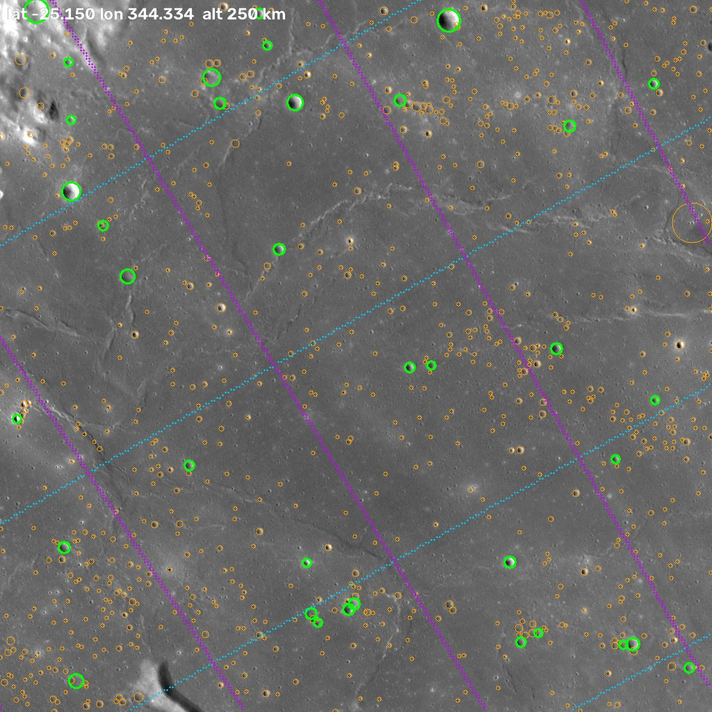

# lunar-platesolve

Blind plate solving for the Moon. Give it one image of the lunar surface and nothing
else. It finds where on the Moon the image is, and where the camera was: latitude,
longitude and altitude, plus pointing, heading and the image's ground footprint.

The idea is the same as star plate solving (astrometry.net), with impact craters in place
of stars:

| stars | craters |
|---|---|
| star centroid | crater centre |
| brightness (ranks stars) | diameter (ranks craters, **and** is a measured invariant) |
| star catalog (Gaia, Tycho) | Robbins 2018 lunar crater database, 1.3 M craters ≥ 1 km |
| quad of 4 stars → 4-D hash code | quad of 4 craters → 8-D hash code (geometry + radius ratios) |
| sky is a sphere seen from inside | Moon is a sphere seen from outside → full pinhole camera fit |

## How it works

```
image ──► CraterNet ──► craters (x, y, r) ──► quads ──► KD-tree lookup ──► hypotheses
                                                                 │
          camera fit ◄── grow & verify (log-odds) ◄──────────────┘
          (lat, lon, alt, attitude, focal length)
```

### 1. Crater detection: `lunarsolve/model.py`, `lunarsolve/synth.py`

A crater looks different under every sun angle: a bright crescent at low sun, a dark ring
at high sun, half of it in black shadow. Classical circle fitting fails on this. **CraterNet**
is a 6 M-parameter U-Net with CenterNet-style heads (stride 2). It predicts a heatmap of
crater *centres* and regresses the radius. It learns where the centre is from the shading
pattern, whatever the lighting.

Training data comes from two sources, both labelled from the Robbins catalog:

* **Synthetic renders of the LOLA DEM** (GPU). A random location, scale (0.6 to 4 km/px),
  sun elevation (1.5° to 75°) and azimuth. Lunar-Lambert shading, cast shadows (a running
  maximum along sun-aligned rows), sphere curvature, albedo noise, blur, gamma and sensor
  noise. Mild anisotropy simulates oblique views. This covers lighting the real mosaic
  does not have.
* **Real LROC WAC 100 m mosaic crops** (CPU workers, 0.25 to 3 km/px). These cover real
  texture and albedo.

Craters outside the trainable radius band (3 to 48 px), or below the catalog's completeness
limit, are *ignored* in the loss, not treated as negatives. At inference, an image pyramid
extends the radius range. Longitudes 330° to 360° are held out of training.

### 2. Quad index: `lunarsolve/quads.py`, `lunarsolve/index.py`

For four craters A, B, C, D (A–B the most distant pair, C and D inside the circle with
diameter AB), place A at (0, 0) and B at (1, 0). The code is

```
[xC, yC, xD, yD,  wR·(ln rA − m), wR·(ln rB − m), wR·(ln rC − m),  wS·(m − ln|AB|)]
```

Here m is the mean log radius. All eight numbers stay the same under any rotation, scale and
translation of the image. Symmetry is broken as in astrometry.net, and queries near a
symmetry boundary try the alternative labellings. The radius weights *whiten* the code: they
scale log-radius noise (about 0.08) to positional noise (about 0.02). This turned out to be
the most important tuning choice. It cut false index hits by about 30 times at the same recall.

The index has 15 scale levels (quad size 8 km to 1450 km). At each level, a Fibonacci lattice
covers the sphere, and at each lattice point the 9 largest nearby craters of a suitable size
form up to 6 quads. That is 8.6 M quads in one 8-D KD-tree.

### 3. Solver: `lunarsolve/solve.py`

1. Query quads come from two sources, interleaved: the N largest detections
   (N = 8 → 40, like brightest stars), and a *local rule* that reproduces the index
   construction in pixel space. The local rule matters in crowded terrain, where the
   globally largest craters do not make the locally chosen index quads.
2. Index hits are verified **closest-code-first**. Chance hits fill the 8-D tolerance ball
   uniformly, so they pile up near its edge, while true hits sit near the centre.
3. Each hit gives a similarity transform to a local tangent plane. A cheap check against the
   catalog filters it. Survivors grow outward from the quad, from similarity to affine to
   homography. They are then scored with a log-likelihood ratio: matched detections against
   the chance of a random catalog crater of similar size nearby. Detections below the
   catalog's completeness limit carry no weight either way.
4. A full pinhole camera is fitted (robust PnP RANSAC init, then robust least squares). All
   detections are re-matched through the camera and the fit is repeated. Without a known
   focal length, the fit is profiled over field of view, then the focal length is freed.
   The final camera solution must pass the log-odds threshold again.

## Results

Benchmarks use random cameras: altitude 30–1500 km, field of view 5–40°, tilt 0–20°,
any heading, latitudes within ±80°, 1024×1024 images. They come from `scripts/eval_sim.py`.
A solve counts as correct when the image centre is within about 4% of the footprint width (+1 km). *Wrong*
means a solution was returned but it was not correct. *Altitude error* is the median over
correct solves.

| test | focal length | solved | wrong | median solve time | median altitude error |
|---|---|---|---|---|---|
| simulated detections (catalog + 8% noise, 25% missed, 15% false) | given | 55 / 60 | 0 | 0.23 s | 0.02% |
| simulated detections | **unknown** | 55 / 60 | 0 | 0.40 s | 1.1% |
| real WAC imagery, CraterNet detections | given | 38 / 40 | 0 | 0.46 s | 0.01% |
| real WAC imagery, CraterNet detections | **unknown** | 36 / 40 | 0 | 0.96 s | 0.39% |
| real WAC imagery, held-out longitudes 330–360° | given | 27 / 30 | 0 | 0.43 s | 0.02% |
| LOLA renders, random sun 3–60°, held-out longitudes | given | 20 / 30 | 0 | 0.42 s | 0.01% |

Across all 260 test views, the solver returned **no wrong solution**. Most failures are
footprints with fewer than about 10–20 catalog craters (mare, or small footprints). The
DEM renders show that lighting is not what limits the solver: 7/11 solved at sun elevation
below 15° and 8/10 above 35°. Geometry is: 16/17 solved below 12° tilt, against 4/13 at
12° or more. The DEM's 473 m resolution forces those views to 800–1500 km altitude, where
tilt plus curvature makes the surface very oblique.

With an unknown focal length, the reported altitude σ is honest. In the blind real-imagery
run, 35 of 36 altitudes lie within 2σ, and near-nadir views (where altitude and focal length
are degenerate) report σ of tens to hundreds of percent rather than a wrong number.

Detection takes 65 ms for a 1 MP image and 190 ms for 4 MP (RTX 4060 laptop GPU). The
CraterNet validation on held-out longitudes against the catalog: precision 0.62, recall 0.59,
radius error 7% (WAC); precision 0.58, recall 0.51 (DEM renders). Many "false positives"
are real craters below the catalog's completeness limit.

Example ([`examples/`](examples)): a held-out view rendered from 250 km with a 20° FOV and
12° tilt, solved blind with no focal length:

```
$ python -m lunarsolve examples/wac_view.png --overlay solved.png
985 craters detected in 872 ms        (first call, includes CUDA warm-up; 65 ms warm)
camera        lat -23.4749  lon 345.0080  altitude 249.7 km +/- 3.6 (focal length estimated)
image centre  lat -25.1500  lon 344.3338  GSD 88 m/px  heading 30.0 deg  off-nadir 12.1 deg
focal 2933 px (FOV 19.81 deg)  mirrored=False
36 crater matches, rms 0.93 px, log-odds 176, 725 ms
```
(truth: camera −23.5°, 345.0°, 250 km, FOV 20°, heading 30°, off-nadir 12°)



## Usage

```bash
python -m lunarsolve image.png
python -m lunarsolve image.png --fov 20 --overlay solved.png --json result.json
```

```python
from lunarsolve.solve import Solver
solver = Solver()                      # loads catalog + index (a few seconds), reuse it
sol = solver.solve(img=gray_float_image, fov_deg=None)
print(sol.summary())
lat, lon = sol.pixel_to_latlon(u, v)
```

Output fields: camera latitude, longitude and altitude (km above the 1737.4 km sphere), its
uncertainty, focal length / FOV (given or estimated), image-centre latitude and longitude,
GSD, heading of image-up (clockwise from north), off-nadir angle, mirror flag, matched
craters, RMS residual and log-odds.

### About altitude

The image scale fixes only *altitude / focal length*. The altitude itself comes from
perspective: keystone distortion from tilt, and the curvature of the Moon across the
footprint. For wide or oblique views this is enough, and the solver estimates both. For
narrow near-nadir views it is not. The solver then reports a large `altitude_sigma_km`,
and you should pass `--fov` or `--focal`.

## Setup

```bash
pip install torch --index-url https://download.pytorch.org/whl/cu128   # or the CPU build
pip install -r requirements.txt
python scripts/setup_data.py          # Robbins catalog + LOLA DEM (~0.8 GB), builds the index
python scripts/setup_data.py --wac    # + LROC WAC mosaic (6 GB), only for training / benchmarks
```

Data goes to `$LUNARSOLVE_DATA` (default `~/.cache/lunarsolve`). The trained detector
weights are in `weights/craternet.pt`.

### Training and benchmarks

```bash
python -m lunarsolve.train --iters 25000          # ~1.7 h on an RTX 4060 laptop GPU
python scripts/eval_sim.py --mode fake            # solver only: catalog craters + noise
python scripts/eval_sim.py --mode wac             # real WAC imagery through random cameras
python scripts/eval_sim.py --mode dem             # LOLA renders with random sun angles
python scripts/eval_sim.py --mode wac --lon 330 360   # held-out longitudes only
python -m pytest tests
```

## Limitations

* **Minimum footprint.** The catalog is complete only to about 1–2 km diameter. An image
  needs roughly 10 or more catalog craters, so footprints below about 20–30 km (or smooth
  mare at any scale) often fail. Most benchmark failures are this case.
* **Strong obliquity.** Quad codes are similarity-invariant. The solver retries with
  guessed de-foreshortening warps, but views where the local surface is seen more than
  about 35° from nadir (tilt plus the Moon's curvature across a large footprint) still fail
  more often.
* **Altitude without a focal length.** See *About altitude* above. In about 1 of 30
  oblique real-imagery views, the pose and the correspondences converged together to a
  wrong but self-consistent solution: correct location, but altitude about 50% off, with too
  small a σ.
* **Test imagery.** The real-imagery benchmarks use the LROC WAC mosaic draped on LOLA
  terrain and seen through simulated cameras. That is real texture and real crater
  morphology, but the lighting is the mosaic's fixed lighting. Spacecraft frames,
  telescope photos and Apollo photos have not been tested yet. Effects not modelled:
  lens distortion, rolling shutter, strong compression, and the limb in view (full-disk
  images).
* **Speed.** Most images solve in about 0.1–0.8 s after detection (about 50–100 ms on GPU for
  1 MP). Hard images can use the whole time budget (default 20 s). Loading the catalog and the
  8.6 M-quad index takes about 4 s, so keep one `Solver` alive for batch work.
* **GPU.** Detection runs on CUDA by default. It also runs on CPU (`--device cpu`), more slowly.

## Data sources

* Robbins, S. J. (2019), *A new global database of lunar impact craters > 1–2 km*,
  JGR Planets 124, 871–892. Distributed by USGS Astrogeology.
* LRO LOLA gridded elevation model LDEM_64 (NASA PDS Geosciences Node).
* LRO LROC WAC global morphologic mosaic, 100 m/px (NASA / GSFC / Arizona State University,
  distributed by USGS).
